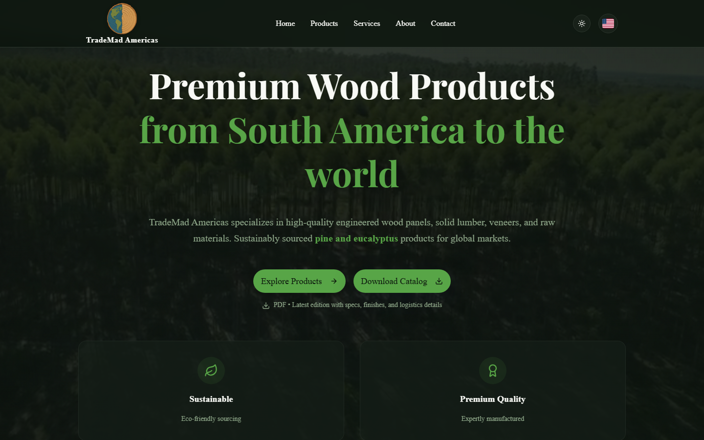

# TradeMad Americas: site institucional

Site institucional e catálogo de produtos da **TradeMad Americas**, exportadora de produtos de madeira (pinus e eucalipto) da América do Sul para o mercado global.

🔗 **No ar:** [trademad.com.br](https://trademad.com.br)



## Destaques

- **Três idiomas** (inglês, português e espanhol) com troca instantânea
- **Tema claro e escuro**
- **Catálogo de produtos** com detalhes em modal e download do catálogo em PDF
- **Contato direto pelo WhatsApp**
- **SEO:** metadados Open Graph e dados estruturados (JSON-LD)
- **Deploy automático** no GitHub Pages com GitHub Actions

## Stack

Next.js 15 · React 19 · TypeScript · Tailwind CSS · shadcn/ui · GitHub Actions

## Rodando localmente

```bash
npm install
npm run dev
```

---

**English:** Corporate website and product catalog for TradeMad Americas, a South American exporter of pine and eucalyptus wood products. It is trilingual (EN/PT/ES), has light and dark themes, a product catalog with PDF download, WhatsApp contact and SEO structured data, and deploys to GitHub Pages with GitHub Actions. Live at [trademad.com.br](https://trademad.com.br).
